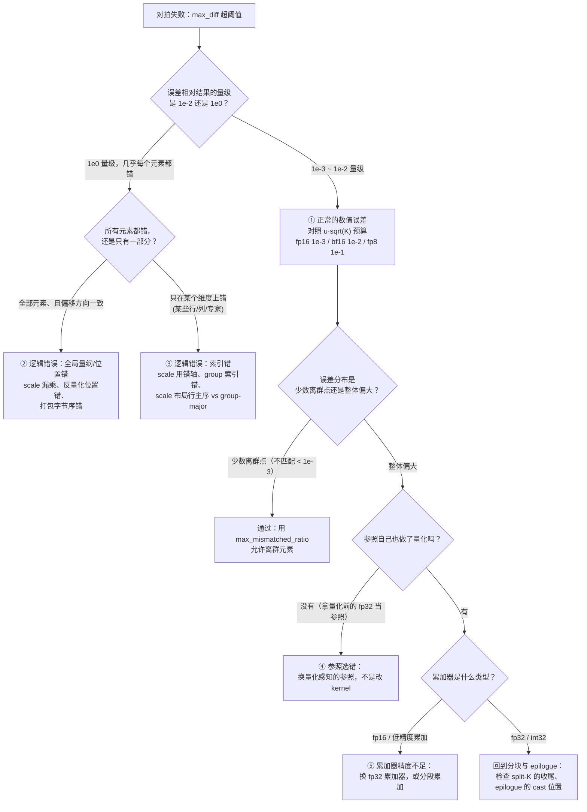

# 图 5：把「对不上」分成四类

用于正文第 5.4 节与第 7 节。低精度算子的对拍失败有四种性质完全不同的原因，
第一件要做的事是分类，而不是调容差。



## ASCII 版（判定顺序）

```text
1. 先算三个指标，缺一不可
     相对 L2       —— 整体是不是「同一个量级」
     逐元素 max    —— 有没有少数大离群点
     不匹配比例    —— 是全局错还是局部错

2. 用「误差 / 结果量级」而不是「误差 / 容差」来分类
     ≈ 1            全局性错误（量纲、scale 位置、字节序）
     1e-1 ~ 1e-2    正常量化误差（对照 u·sqrt(K)）

3. 记住低精度的三条基准线（u，单元素相对上界）
     fp16 4.9e-4   bf16 3.9e-3   int8 3.9e-3
     fp8 e4m3 6.3e-2   int4 7.1e-2   fp4 e2m1 2.5e-1（模型在 fp4 上失效）

4. 参照必须先对齐
     参照 = 同一个量化规则 + 同一个粒度 + 同一个累加类型（或更高）
     只有「两边一致」是不够的：两边犯同一个错也会通过
```

## 配套实验

| 分类 | 复现实验 | 实测数字 |
| --- | --- | --- |
| 正常的数值误差 | `code/02-quant-dequant/quant_dequant.py` | int8 per-channel 7.67e-3；MXFP8 2.69e-2 |
| 全局逻辑错误 | `code/05-mx-scale-layout/mx_scale_layout.py` | 字节序错 5.58；粒度错 2.77 |
| 索引逻辑错误 | `code/05-mx-scale-layout/mx_scale_layout.py` | 行主序错 2.47（组数 = 1 时不暴露） |
| 参照选错 | `code/04-vs-reference/reference_matching.py` | D 行 1.08e-1 失败但不是 bug |
| 累加器精度 | `code/03-error-model/error_model.py` 实验 C | 1.24e-4 → 1.24e-9（换 fp32 累加器） |

## 来源

* 容差模型：第 12 章第 3.7.1 节与 `chapters/12-debugging-and-profiling/code/02-tolerance-model/`。
* 判据默认值：`_vendor/tilelang-v0.1.15/tilelang/utils/tensor.py:205`、
  `_vendor/tilelang-v0.1.15/tilelang/profiler/__init__.py:104`、
  `_vendor/tilelang-ascend-v0.1.2.000/examples/quant_batch_matmul/example_quant_batch_matmul.py:116`。
