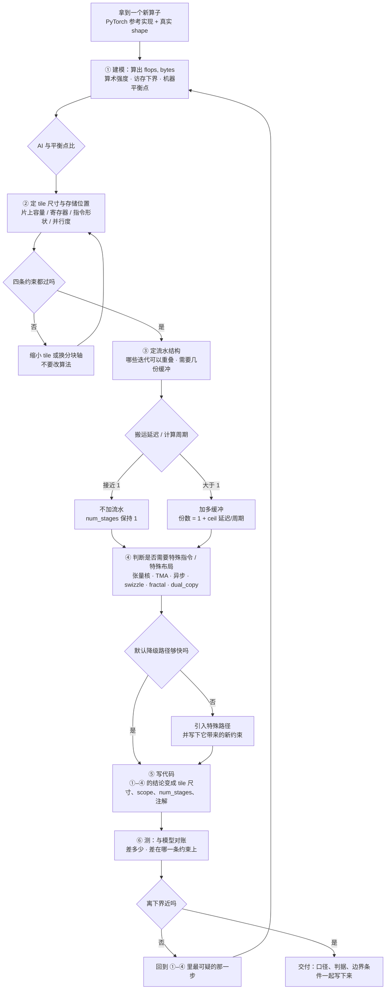

# 图 1：拿到一个新算子的设计流程

**用途**：正文第 1.2 节。这张图是本章的总纲，**代码是最后一步，不是第一步**。

## 流程里最容易跳过、也最贵的两步

| 步骤 | 跳过它的典型后果 | 本章对应 |
| --- | --- | --- |
| ① 建模 | 花了三天调参，最后发现算子的 AI 比平衡点低两个数量级，调参空间本来就没有 | 第 2 节 |
| ② 定 tile | `block_M=256, block_N=256` 编不过，或者编过了但掉到 1 block/SM | 第 4 节 |

## 来源

本书自绘。每一步用到的定量工具分别在正文第 2、3、4 节给出；流程中“先粗算再微调”
的顺序来自 `code/04-tile-size-decision/` 的实际输出（459 个可行配置、8 个并列）。
