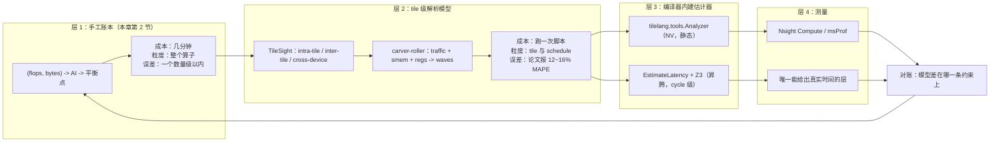

# 图 3：四种性能模型的定位

**用途**：正文第 3.5 节。这张图回答「什么时候该用哪个模型」。

## 四个模型的「能答 / 不能答」

| 模型 | 能回答 | 不能回答 | 出错时的样子 |
| --- | --- | --- | --- |
| 手工账本（`code/01`） | 这个算子是不是 memory-bound；下界是多少 | 具体 tile 配置；任何绝对时间 | 用错 roof（图 2 的 M2/M3） |
| TileSight（R4、R5） | 给定 tile 与 schedule，kernel body 的延迟与 cache 命中率 | 编译器实际生成的代码是什么 | 论文自报 12.35% MAPE，不是零误差 |
| carver-roller（S1–S20） | 哪些 tile 配置不可行；top-k 候选的排序 | 绝对性能；`block_K` 的取舍（无分辨率） | 大量并列（`code/03`：154 个候选 48 个不同值） |
| `Analyzer`（S21–S27） | 一个 GEMM 的 FLOPs 与跨 global 边界的字节数 | 逐元素算术、非 `T.copy` 的访存、sm_90/sm_100 的算力 | `expected_tflops` 为 `None`，`estimated_time` 静默退化成访存时间 |
| 昇腾 `EstimateLatency`+Z3（S28–S34） | 每条 pipe 的 latency 与 II；调度顺序 | 芯片换代的常量标定；模型偏小方向的误差 | 常量不对时「从慢变成错」（第 23 章 5.1） |

## 来源

* TileSight：R4（arXiv 2607.22432 摘要）与 R5（仓库 README 转录）；
  `../references.md` 里注明了「只有摘要、无源码」。
* carver：S1–S20（`_vendor/tilelang-v0.1.15/tilelang/carver/`），数字来自 `code/03`。
* `Analyzer`：S21–S24（`tilelang/tools/Analyzer.py:10,58-106,172-213` 与
  `docs/tools/analyzer.md:98-112`）。
* 昇腾：S28–S34（`estimate_latency.h/.cc`、`z3_scheduler.py`、`ascend/pipeline.py`）。
