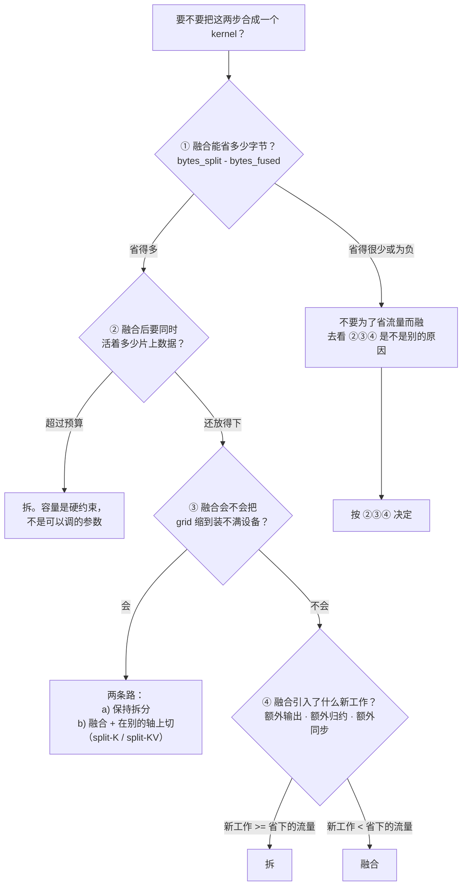

# 图 5：fusion / split 的四个问题

**用途**：正文第 5.1–5.2 节。

## 四个问题在六个真实取舍上的答案（`code/05` 的实际输出）

| 取舍 | ① 省下的字节 | ② 片上 | ③ grid | ④ 新工作 | 结论 |
| --- | --- | --- | --- | --- | --- |
| 逐元素链，2 个算子 | 67.1 MB | 2 KB，宽裕 | 32768→16384，够 | 无 | 融合 |
| QK-Norm+RoPE 与量化 | 83.9 MB | 104 KB / 192 KB 预算 | 163840→20480，够 | 无 | 融合 |
| GEMM 与 bias+GeLU epilogue | 67.1 MB | 64 KB，宽裕 | 1024→1024 | 无 | 融合 |
| 瘦长 GEMM 的 split-K | **−67.1 MB**（更贵） | 64 KB | **64→512（原来装不满）** | 部分和回写 | **split-K** |
| decode attention 的 split-KV | **−2.1 MB** | 128 KB | **32→2048（原来装不满）** | 部分和归约 | **split-KV** |
| 归一化融进 Q 投影的输出 | 67.1 MB | 96 KB，宽裕 | 16384→1024，够 | 无 | 融合 |

后两行是这张表存在的理由：**同一个判据，在并行度不足时会给出与流量相反的答案。**

## 来源

`code/05-fusion-split/fusion_split.py` 的实际输出；判据本身是本书的归纳，
不是某个厂商文档的规定。
