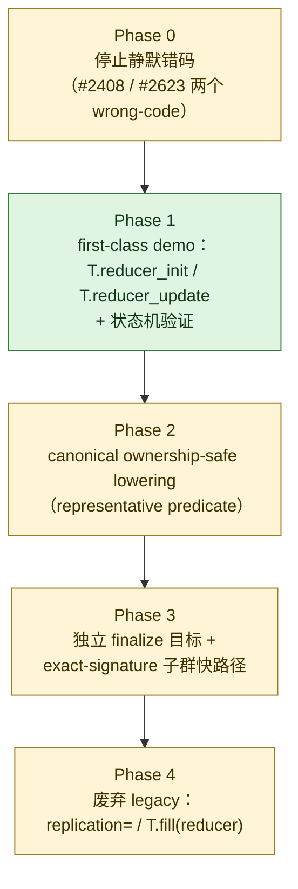

# 图 5：RFC #2897 的阶段与落地情况（自绘）

RFC #2897 提出“ownership-safe deferred reduction”，并自己列了四个阶段。
把阶段和 v0.1.14 / v0.1.15 的实际代码对照，会得到一张**与直觉相反**的图：
这个 RFC 的主体语义已经随 release 发布了。

## 代码里的证据（都在 v0.1.15）

| RFC 里的东西 | v0.1.15 里的落点 | 状态 |
| --- | --- | --- |
| v2 API：`T.alloc_reducer` / `T.reducer_init` / `T.reducer_update` / `T.finalize_reducer(acc, dst)` | `tilelang/language/allocate.py:296`、`tilelang/language/reduce_op.py:358,398,434` | 已实现（且 v0.1.14 就有） |
| 状态机校验（init/update/finalize、禁止 finalize 前读、禁止任意 store） | `src/transform/verify_reducer_epoch.cc` | 已实现 |
| legacy 语法规范化 shim（`acc[i] += v` → `tl.reducer_update`） | `src/transform/canonicalize_legacy_reducer.cc` | 已实现（严格白名单，白名单外的写法直接报错） |
| 物理计划物化 | `src/transform/reducer_plan_materialize.cc` | pass 存在并挂进 pipeline（v0.1.15 有改动）；本次**未**逐行核对其内部谓词实现 |
| 挂进所有后端 | `tilelang/cuda/pipeline.py:91-92`、`tilelang/ascend/pipeline.py:74-75`、rocm/metal/cpu/webgpu 同名两行 | 已实现 |
| 独立 finalize 目标 | `T.finalize_reducer(acc, dst)` 已存在；legacy 原地 finalize 仍保留并给出 DeprecationWarning | 部分 |
| 稀疏/分段 partial layout | 没有对应实现 | 未实现（RFC 自己也只是“later work”） |
| 废弃 `replication=` / `T.fill(reducer)` | 仍在；`examples/gemv/example_gemv.py:239,250` 还在用 legacy 写法 | 未实现 |

## 为什么这张图重要

`08-frontier-unmerged/` 这个 corpus 目录名容易让人以为里面全是“没落地的”。
但目录名描述的是**资料的收集动机**（前沿与未合入话题），不是每一条的落地状态。
判断落地状态只能看代码，这也正是本章 §5.1 要讲的核心。
