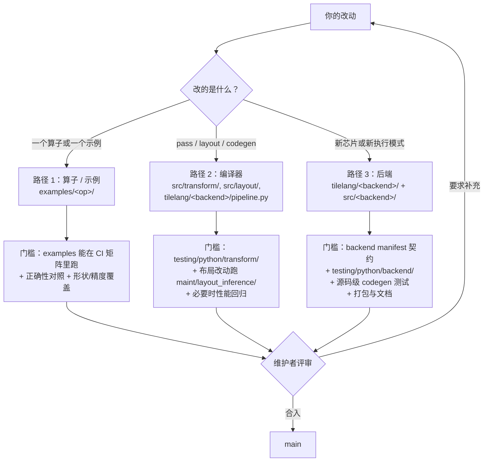

# 三种贡献路径（图 31-1）

| | 路径 1 · 算子/示例 | 路径 2 · 编译器 | 路径 3 · 后端 |
| --- | --- | --- | --- |
| 典型落点 | `examples/<op>/` | `src/transform/*.cc`、`tilelang/transform/__init__.py`、`tilelang/<backend>/pipeline.py` | `tilelang/<backend>/`、`src/<backend>/`、`CMakeLists.txt` |
| 上手难度 | 低（会 TileLang 即可） | 中（要读 TIR 与 pass 顺序） | 高（要同时懂 lowering、codegen、构建） |
| 需要硬件 | 视算子而定 | 通常不需要（可做 IR 级测试） | 通常需要在目标硬件上冒烟 |
| 最容易卡在哪 | 没有测试、只在本地能跑 | 把风格改动和语义改动混在一个 PR | 在 `engine/lower.py` 里加 target 分支 |

参考：`.agents/skills/tilelang-backend/references/integration-checklist.md` 的
Scope Matrix（新目标后端 / 同 target kind 的变体 / 新执行模式三条子路径）。
