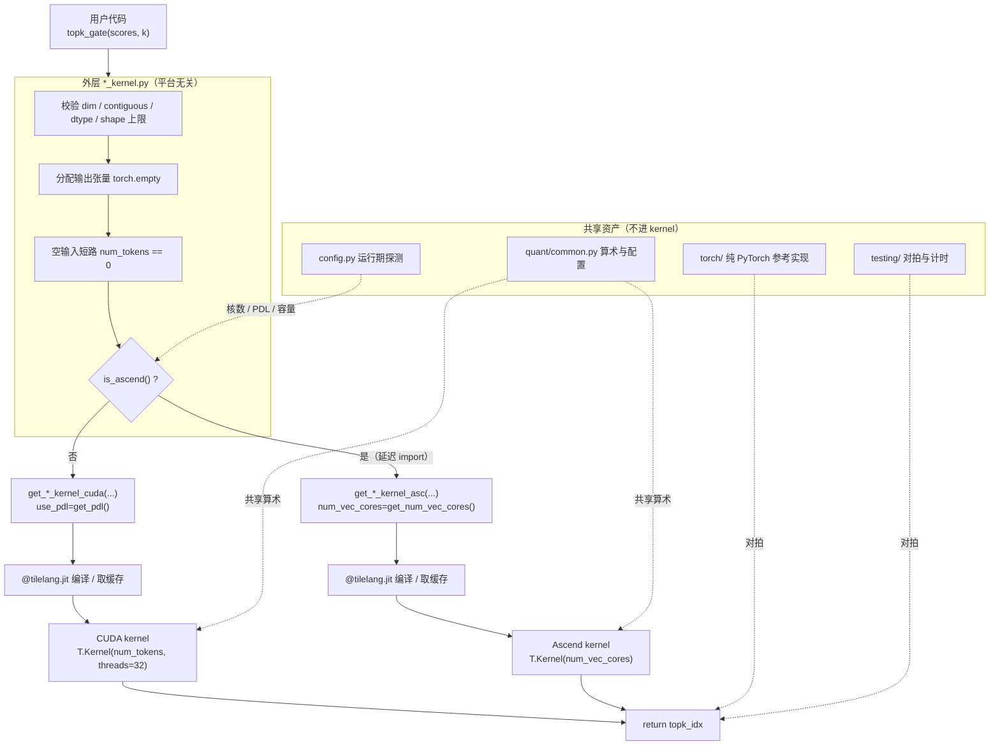

# 图 1：TileKernels 的三层结构与后端分派

**用途**：正文 §2.1–§2.4。

事实来源：`../tilelang-corpus/14-deepseek-ascend-stack/raw/TileKernels/README.md:73-89`
（Project Structure）与 `tile_kernels/moe/topk_gate_kernel.py:1-43`（分派入口）；
`tile_kernels/torch/__init__.py:1-25`、`tile_kernels/testing/numeric.py:5-38`。

## 要点

* 三层是**文件边界**，不是逻辑分层：`*_kernel.py` / `*_cuda.py` / `*_asc.py`。
* 分派发生在**工厂函数被调用**时；核数等型号相关值在那一刻成为编译期常量。
* 共享资产（参考实现、对拍工具、配置、算术）**不进入 kernel**，
  但被两个后端共同依赖。
* `tests/**` 只调用外层 API，因此同一份测试同时覆盖两个后端。

## 三代同源的写法

| 层 | 典型内容 | 平台相关？ |
| --- | --- | --- |
| `*_kernel.py` | 校验、分配、短路、分派 | 否 |
| `*_cuda.py` | `@tilelang.jit` + `T.prim_func`，CUDA 并行映射 | 是 |
| `*_asc.py` | `@tilelang.jit` + `T.prim_func`，昇腾并行映射 | 是 |
| `torch/`、`testing/` | 参考实现、误差口径、形状生成 | 否 |
