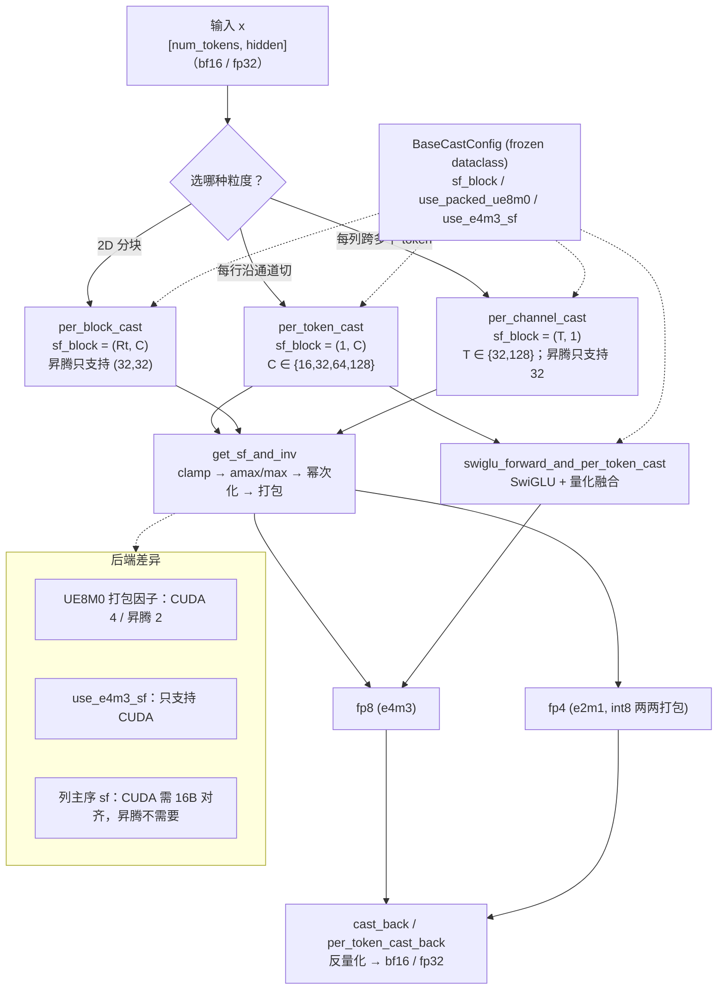

# 图 4：量化算子族地图

**用途**：正文 §5.1、§5.3–§5.5。

事实来源：`.../TileKernels/tile_kernels/quant/__init__.py:1-11`（导出清单）；
`quant/common.py:19-33,70-75,174-185,251-282`；三个 `*_kernel.py` 的分派段
（`per_token_cast_kernel.py:37-62`、`per_block_cast_kernel.py:42-61`、
`per_channel_cast_kernel.py:57-62`）；`swiglu_forward_kernel.py:40-76`。

## 读图提示

* **粒度是 `sf_block` 的形状**，不是「块大小」：`(1, C)` 是 per-token、
  `(Rt, C)` 是 per-block、`(T, 1)` 是 per-channel。
* 三个 cast 共用同一段算术（`get_sf_and_inv`）、同一套配置（`BaseCastConfig`），
  因此两个后端的舍入与 clamp 口径**不可能不一致**。
* 融合路径（SwiGLU + per-token cast）省掉的是「SwiGLU 结果写回 GM、再读回来量化」
  这一趟往返；代价是多套 UB 缓冲。
* 图中的三条后端差异会让 sf 张量的**形状或取值**不同，因此
  跨设备搬运权重时必须重新打包。
