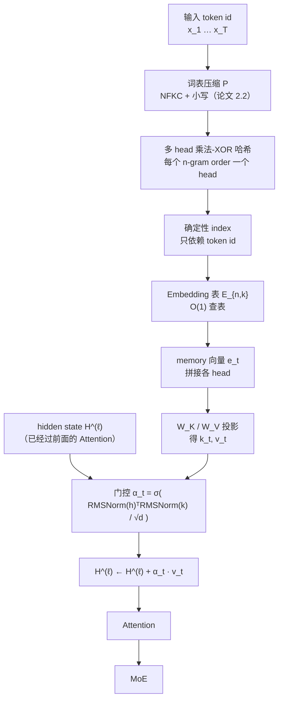

# 图 1：Engram 在一个 Transformer 层里的位置与数据流

对应正文第 1.2 与 2.1 节。要点：**Engram 是挂在残差流上的一条旁路**，输入是
token id（不是 hidden state），输出通过一个门控信号调制后加回 `H^(ℓ)`；它不替换
Attention / MoE，而是与之并列。

## Mermaid 版本



## ASCII 版本

```text
                        一个 Transformer 层
   ┌────────────────────────────────────────────────────────────┐
   │                                                            │
   │   x_t (token id) ──► 压缩 ──► 哈希 ──► 查表 ──► e_t        │
   │                                        (确定性 index,       │
   │                                         O(1) 次访问)        │
   │                                            │               │
   │                                            ▼               │
   │                                W_K e_t = k_t , W_V e_t = v_t│
   │                                            │               │
   │   H^(ℓ) ──────────────────────┐            │               │
   │                               ▼            ▼               │
   │                     α_t = σ( RMSNorm(H)ᵀ · RMSNorm(k) / √d )│
   │                               │                            │
   │                               ▼                            │
   │                   H^(ℓ) ← H^(ℓ) + α_t · v_t    ← 残差连接   │
   │                               │                            │
   │                               ▼                            │
   │                          Attention → MoE                   │
   └────────────────────────────────────────────────────────────┘

   两条稀疏轴（论文的说法）：
     MoE      = conditional computation —— 用 hidden state 动态选专家
     Engram   = conditional memory      —— 用 token id 确定性取静态记忆
```

## 读图要点

1. **输入是 token id，不是 hidden state。** 这是 Engram 与 MoE 最本质的区别：
   MoE 的路由依赖运行期隐藏状态，Engram 的 index 在**前向开始前**就定了。
   因此前者不能预取，后者可以。
2. **门控是“对齐检查”。** `α_t` 是 hidden state 与 memory 经过 RMSNorm 后的
   余弦型相似度（再乘 `1/√d`、再套 signed-sqrt 与 sigmoid）。如果取回的静态记忆与
   当前上下文相矛盾，`α_t → 0`，噪声被抑制（论文 2.3 节的表述）。
3. **不是每层都挂。** 论文 §2.5 说 Engram 的放置位置要同时满足建模与系统延迟两个
   约束：放得早对建模好，放得深则给 host memory 预取留出更多计算窗口。
4. 本图只画了论文 §2.2–2.4 的主干；`hc` 条分支（对应 `hc_mult = 4`）在图 4 里展开。

## 来源

* 结构：`../tilelang-corpus/14-deepseek-ascend-stack/raw/paper-deepseek-engram.md:140-215`
  （retrieval / fusion 两阶段、式 (3)(4)(5)）。
* 训练/推理的系统实现（sharding + All-to-All；host 端预取）：
  `../tilelang-corpus/14-deepseek-ascend-stack/raw/paper-deepseek-engram.md:315-347` 与 `:247-262`。
* 代码侧对应物：`../tilelang-corpus/14-deepseek-ascend-stack/raw/TileKernels/tile_kernels/engram/engram_hash_kernel.py`、
  `engram_gate_fwd_kernel.py`；教学 demo 见 `../tilelang-corpus/14-deepseek-ascend-stack/raw/Engram/engram_demo_v1.py:326-378`。

本图不含任何硬件实测数据。
