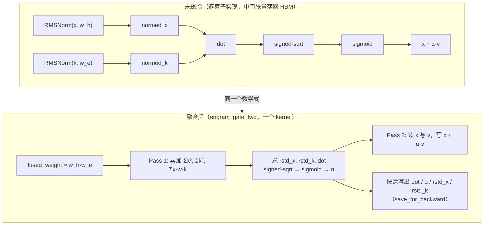

# 图 2：一次门控前向的算子融合

对应正文第 3.1 与 3.2 节。要点：**未融合时要跑 6 个算子、写 5 个中间张量；
融合后是一个 kernel、两遍扫描、只用 3 个标量累加器。**

## Mermaid 版本



## ASCII 版本

```text
（1）未融合：每个算子一个 kernel，中间结果都要经 HBM

  x ─► RMSNorm(x,w_h) ─► normed_x ─┐
                                   ├─► dot ─► signed_sqrt ─► sigmoid ─► α ─► x+αv ─► out
  k ─► RMSNorm(k,w_e) ─► normed_k ─┘
       （w_h 与 w_e 是两个独立权重，两次归一化各写一遍线上数据）


（2）融合：把 w_h·w_e 先乘好，一次扫描同时算三个量

  Pass 1（只读 x, k, weight_fused）
     rstd_x_acc  = Σ x_d · x_d            ┐
     rstd_k_acc  = Σ k_d · k_d            ├─ 三个标量累加器，全程留在寄存器
     dot_acc     = Σ x_d · w_d · k_d      ┘   （w_d = w_h,d · w_e,d）
     ─────────────────────────────────────────
     rstd_x = rsqrt(Σx²/d + eps)
     rstd_k = rsqrt(Σk²/d + eps)
     dot    = dot_acc · rstd_x · rstd_k · d^(-1/2)
     α      = sigmoid( sign(dot)·sqrt(clamp(|dot|)) )
     <= 恒等式 RMSNorm(x,w_h)ᵀ·RMSNorm(k,w_e) = rstd_x·rstd_k·Σ x·w_h·w_e·k

  Pass 2（只读 x, v，写 out）
     out_d = x_d + α · v_d              （x 已在片内，v 是 kv 的最后一行）

  可选：写出 dot / α / rstd_x / rstd_k 四个 (num_tokens, hc_mult) 的 fp32 小张量，
        供反向使用；不训练时整段省掉（save_for_backward=False）。
```

## 读图要点

1. **融合省下的主要是中间张量往返。** `normed_x` 与 `normed_k` 是
   `num_tokens × hc_mult × hidden_size` 级别的张量（bf16/fp32），写成文件再读回来
   正是“访存为主”算子的典型浪费。融合后它们根本不落地。
2. **两次扫描不是浪费。** Pass 1 需要完整的约简结果（`rstd_*`、`dot`）才能算出 `α`，
   而 `α` 又要乘到每个 `v_d` 上。所以必须两遍。CUDA 版把 `x` 留在 shared memory、
   `v` 用双缓冲按 tile 预取，两遍之间不碰 HBM。
3. **`fused_weight` 是个真正的预处理 kernel。** `w_h · w_e` 只在权重更新后变一次，
   所以它被单独算成 fp32（`engram_fused_weight_kernel.py:7`），门控 kernel 每次直接
   读它。这就是“把链式法则里的乘积提前算好”。
4. **signed-sqrt + sigmoid 是有意为之。** `sign(x)·sqrt(|x|)` 把“大负相关”也映射到
   一个有限区间，再交给 sigmoid；`clamp_min(clamp_value)` 防止 `sqrt` 在 0 附近的梯度
   爆炸（反向里那条 `T.Select(abs(dot)·scalar·rstd_x·rstd_k < clamp_value, 0, …)`
   就是它的导数处理，见 `engram_gate_bwd_cuda.py:249-253`）。

## 来源

* 前向数学与恒等式：`code/01-engram-gate-shapes/engram_gate_shapes.py` 的实际输出
  （`max|gate_naive − gate_fused| = 1.19e-07`，fp32）。
* 内核结构：`../tilelang-corpus/14-deepseek-ascend-stack/raw/TileKernels/tile_kernels/engram/engram_gate_fwd_cuda.py:90-195`
  与 `engram_gate_fwd_asc.py:76-222`。
* 权重融合：`../tilelang-corpus/14-deepseek-ascend-stack/raw/TileKernels/tile_kernels/engram/engram_fused_weight_kernel.py:7-16`；
  反向的门控导数：`../tilelang-corpus/14-deepseek-ascend-stack/raw/TileKernels/tile_kernels/engram/engram_gate_bwd_cuda.py:247-253`。

本图不含任何硬件实测数据。
