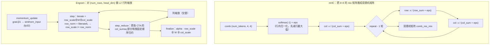

# 图 3：Sinkhorn 迭代——同一个词，两处不同的用法

对应正文第 5.1–5.4 节。要点：**迭代结构都是「交替把行、列拉回目标归一化」，
但 mHC 用的是「先 softmax 再行/列求和归一化」，Engram 用的是「行/列 L2 缩放」。**

## Mermaid 版本



## ASCII 版本

```text
（1）mHC：softmax → 交替行/列求和归一化 → 双随机

   输入 comb[n, 4, 4]（每 token 一个）
        │
        ├─► row softmax：x /= sum_行 exp(x)      ← 先减行最大值，数值稳定
        ├─► + eps
        ├─► 列归一化：x /= (列和 + eps)
        │
        └─► 重复 (repeat - 1) 轮：
                x /= (行和 + eps)
                x /= (列和 + eps)

   每轮迭代的代价：两次 reduce（行和、列和）+ 两次逐元素除法
   迭代粒度：一个 token 一个 CTA / 一条向量任务，全部在片上完成
   结果：行列和都 → 1（相差 eps 量级），即双随机矩阵


（2）Engram：L2 行列缩放的流水线（四个 kernel 接力）

   momentum_update :  grad, momentum ──► sinkhorn_input (fp32)
                        （Nesterov 前瞻，beta1 衰减）
   step            :  iterate = row_scale ⊗ M ⊗ col_scale
                      row_norm = ‖iterate‖₂（逐行）
                      row_scale ← row_scale / (row_norm + eps)   ← 行 L2 归一化
                      写 col_sumsq 的「本 CTA 部分和」
   step_reduce     :  把所有 CTA 的 col_sumsq 部分和按固定顺序相加
                      （确定性归约，逐 kernel 不同机器结果一致）
   finalize        :  out = alpha · (row_scale / (‖iterate‖₂ + eps)) ⊗ M ⊗ col_scale

   与 mHC 的差别：归一化用 L2 范数（不是和）、没有 softmax、没有「双随机」目标，
   只有一个全局 alpha 因子把尺度定住。
```

## 读图要点

1. **迭代为什么放在 kernel 里？** `4 × 4` 的矩阵在片上放得下，迭代过程中**不需要
   回 HBM**；如果每轮都启动一个 kernel，`repeat = 10` 就是 20 次启动 + 20 次往返。
   把整个迭代循环写进一个 kernel，只有进/出两次 HBM 访问。
2. **两种归约的粒度不同。** mHC 的归约轴是 `4`（对每个 token 独立），一个 CTA 就能
   完成；Engram 的归约轴是 `head_dim`（列），必须跨 CTA 归约，所以才能看到
   `step` / `step_reduce` 这对拆分。
3. **`repeat` 是可调的精度旋钮。** `mhc_sinkhorn` 的 `repeat = 10` 是测试与融合 kernel
   默认值（`tests/mhc/test_sinkhorn.py:19`、`tests/mhc/test_pre_big_fuse.py:24`）；
   `code/02` 显示 `repeat = 10` 时行和偏差约 `5.7e-3`，`repeat = 30` 时降到 `1.4e-6`。
   mHC 的 forward 反向都要重跑这个迭代，所以次数直接进关键路径。
   **注意别和论文的 `t_max` 混用**：论文用 `t_max = 20`，且它的一次迭代是
   「行 + 列」各一次；代码的 `repeat` 从「softmax 之后做一次列归一化」开始计数。
4. **反向也要有对应实现。** `mhc_sinkhorn_bwd` 会把每一步的中间矩阵与行列和
   存下来（`sinkhorn_cuda.py:91-92` 的两块 shared 缓冲），然后**逆序**回放链式法则；
   `pre_big_fuse` 的昇腾版本则是把整个前向 op-for-op 复刻进一个 kernel。

## 来源

* mHC 侧：`../tilelang-corpus/14-deepseek-ascend-stack/raw/TileKernels/tile_kernels/mhc/sinkhorn_cuda.py:24-56`（forward）、
  `:59-155`（backward）；基线 `../tilelang-corpus/14-deepseek-ascend-stack/raw/TileKernels/tile_kernels/torch/mhc.py:8-14`；
  昇腾融合版 `../tilelang-corpus/14-deepseek-ascend-stack/raw/TileKernels/tile_kernels/mhc/pre_big_fuse_asc.py:43-51,236-373`。
* mHC 的**数学定义**现在是论文 §4.1–4.2：双随机约束与 Birkhoff 多胞形
  `../tilelang-corpus/14-deepseek-ascend-stack/raw/paper-deepseek-mhc.md:349-376`；
  式 (8)(9) 的 `Sinkhorn-Knopp` 与 `t_max = 20`
  `../tilelang-corpus/14-deepseek-ascend-stack/raw/paper-deepseek-mhc.md:391-406`（Table 5 也是 20：`:1375-1378`）；
  论文 §4.3.1 说迭代放一个 kernel、反向在片上重算并整轮回放：`../tilelang-corpus/14-deepseek-ascend-stack/raw/paper-deepseek-mhc.md:429`。
  论文与源码在「起点 / 首步顺序 / 迭代次数 / eps」上的差异见正文 §5.2 的对照表。
* Engram 侧：`../tilelang-corpus/14-deepseek-ascend-stack/raw/TileKernels/tile_kernels/engram/engram_sinkhorn_kernel.py:13-65,68-106,109-136,139-178`
  与 `engram_sinkhorn_cuda.py:19-250`；基线 `../tilelang-corpus/14-deepseek-ascend-stack/raw/TileKernels/tile_kernels/torch/engram.py:6-96`。
* 迭代收敛与稳定性数据：本图引用的数字来自 `code/02-sinkhorn-iterations/` 的
  **CPU 实际输出**（小矩阵、torch 2.1.1、fp32），不是硬件测量。
* 「双随机」「Sinkhorn-Knopp」的定义以论文 §4.1–4.2 为准；
  corpus 里那份第三方教程（`../tilelang-corpus/06-huawei-ascend/raw/pto-dsl/examples/aot/sinkhorn_demo/pto_sinkhorn_demo_zh.md:1-20`）
  是同一件事的转述，现在只作旁证。
