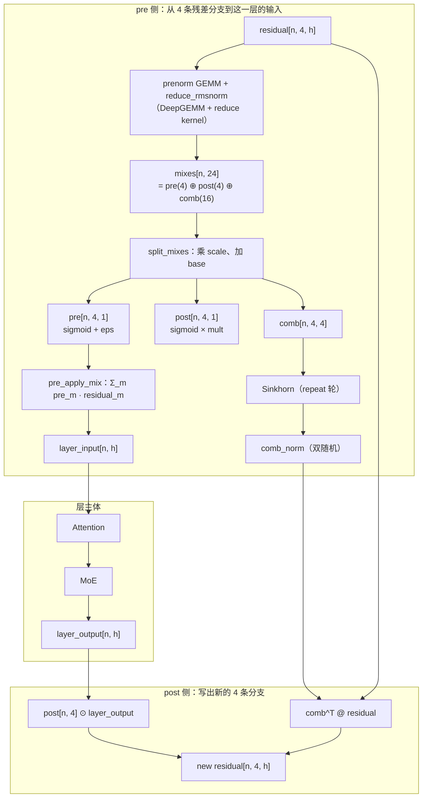

# 图 4：mHC 的 mix 拆分与应用数据流

对应正文第 6.2–6.4 节。要点：**每个 token 的 `mixes`（24 维）被拆成
`pre(4)`、`post(4)`、`comb(4×4)` 三块；`comb` 过 Sinkhorn 成为双随机矩阵，
`pre` 用来把 4 条分支压成一层输入，`post` 与 `comb` 用来写出新的 4 条分支。**

## Mermaid 版本



## ASCII 版本

```text
（1）每个 token 的 24 个 mix 分量 = 2 × 4 + 4 × 4

      mixes[n, 24]
      ├── [ 0 :  4)  pre_layer_mix   → sigmoid(x·s0 + b) + eps        （4 个）
      ├── [ 4 :  8)  post_layer_mix  → sigmoid(x·s1 + b) × mult       （4 个）
      └── [ 8 : 24)  comb_res_mix    → x·s2 + b ，再 reshape 成 4×4    （16 个）

      scale 是 3 个数（对应上面三段各一个），base 是 24 个数
      —— 见 pre_split_mixes_cuda.py:54-64 与 torch/mhc.py:27-49


（2）调用链（前向）            （3）形状与语义

   residual [n,4,h]                     pre   [n,4,1]  每分支一个缩放
        │                                post  [n,4,1]  每分支一个缩放
        ▼                                comb  [n,4,4]  分支之间的连接权重
   prenorm GEMM ──► 部分和               comb 过 Sinkhorn → 双随机
        │
        ▼
   reduce + rmsnorm ──► mixes [n,24]
        │
        ├─► split_mixes ──► pre / post / comb ──► Sinkhorn ──► comb_norm
        │
        ├─► pre_apply_mix(residual, pre) ──► layer_input [n,h]
        │        （Attention → MoE → layer_output）
        │
        └─► post(layer_output, residual, post, comb_norm)
                 new_res[o] = post[o] · layer_output + Σ_m comb[m,o] · residual[m]

   边界算子：
     expand          : x[n,h]           → [n,4,h]     （反向：对 4 条求和的归约）
     head_compute_mix: mixes [n,4]       → sigmoid(x·scale + base) + eps
     multilayer_recompute: 把上面的 pre/post 递推在 L 层上循环重算
```

## 读图要点

1. **`comb` 是唯一被约束到流形上的量。** `pre` 与 `post` 只是逐分支的 sigmoid 门，
   真正表达「分支之间怎么混合」的是 `comb`；把它约束成双随机矩阵，意味着
   **信息在 4 条分支之间重新分配但总量受控**。
2. **`residual` 有两条消费路径**：一条经 `pre_apply_mix` 变成层的输入，另一条经
   `comb^T` 直接进入下一时刻的残差。这就是「hyper-connection」相对于普通残差
   （`h ← h + f(h)`）多出来的那条。
3. **pre 侧与 post 侧在同一个 kernel 里可以让不同 warp 干不同的事。**
   `pre_big_fuse_cuda.py:50-106` 用 `T.get_thread_binding() < 32` 把 CTA 分成两组：
   前 32 个线程做 mix 的归约、拆分与 Sinkhorn，其余线程做 `pre_apply_mix` 的逐元素
   部分——这是「一个 kernel 里塞两条不同流水」的写法。
4. **`expand`/`post` 都在反向里出现。** `expand` 的反向是分支求和，
   `post` 的反向要同时产出 `d_residual`、`d_post_mix`、`d_comb_mix`、`d_x` 四项
   （`post_cuda.py:66-155`）。

## 来源

* 形状与语义：`../tilelang-corpus/14-deepseek-ascend-stack/raw/TileKernels/tile_kernels/mhc/pre_split_mixes_cuda.py:24-68`、
  `pre_apply_mix_cuda.py:24-53`、`post_cuda.py:27-60`、`head_compute_mix_cuda.py:30-35`、
  `expand_cuda.py:6-27`；基线 `../tilelang-corpus/14-deepseek-ascend-stack/raw/TileKernels/tile_kernels/torch/mhc.py:17-63`。
* 融合实现与「按 warp 分工」：`../tilelang-corpus/14-deepseek-ascend-stack/raw/TileKernels/tile_kernels/mhc/pre_big_fuse_cuda.py:44-135`；
  昇腾的 op-for-op 复刻：`../tilelang-corpus/14-deepseek-ascend-stack/raw/TileKernels/tile_kernels/mhc/pre_big_fuse_asc.py:43-51`。
* 数值演示：`code/03-mhc-mix-flow/mhc_mix_flow.py` 的 CPU 实际输出。
* 论文依据（一手）：`../tilelang-corpus/14-deepseek-ascend-stack/raw/paper-deepseek-mhc.md`
  §3 式 (1)–(5) 的 n 流残差与三个映射（`:198-255`）、§4.1 式 (6) 的双随机约束
  （`:349-376`）、§4.2 式 (7)(8) 的参数化与约束（`:378-399`）、
  §4.3.1 的 `F_pre` / `F_post,res` 两个应用 kernel 与 IO 收益（`:501`）。
  图中「pre 侧 / post 侧」这两条数据流就是论文式 (3)(4) 的代码形态。
* 论文与实现的两处差异（本图沿用实现）：`post` 的 `2σ` 在代码里是参数
  `mhc_post_mult_value`（测试默认 `1.0`，`tests/mhc/test_pre_big_fuse.py:23`），
  `pre` 在代码里额外加了 `mhc_pre_eps`。详见正文 §5.2 与 §6.2。
