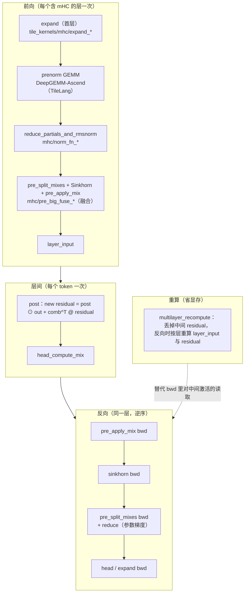

# 图 5：mHC 各 kernel 与一次训练 step 的对应

对应正文第 6.6 与 7.3 节。要点：**mHC 的一半算子挂在每一层的前向/反向里，
另一半是因为「反向要重算」才存在的**；prenorm GEMM 在 DeepGEMM（Ascend C 为主），
其余的 mix/Sinkhorn 算子用 TileLang 写。

## Mermaid 版本



## ASCII 版本

```text
  一次 step，逐层展开（只画 mHC 相关部分）

  ┌──────────────── 前向 ────────────────┐   ┌──────── 反向 ────────┐
  │                                      │   │                      │
  │  expand            (只有第 0 层)      │   │  expand bwd（分支求和）│
  │    │                                 │   │       ▲              │
  │  prenorm GEMM      DeepGEMM-Ascend   │   │       │              │
  │    │               （TileLang 实现）  │   │   head_compute_mix   │
  │  reduce + rmsnorm  → mixes [n,24]    │   │       bwd            │
  │    │                                 │   │       ▲              │
  │  split_mixes ──► Sinkhorn ──► comb   │   │  pre_split_mixes bwd │
  │    │                                 │   │  （写 mhc_scale/base │
  │  pre_apply_mix ──► layer_input       │   │    的梯度部分和，再  │
  │    │                                 │   │    用 reduce kernel  │
  │  Attention + MoE ──► layer_output    │   │    归约）            │
  │    │                                 │   │       ▲              │
  │  post（写新的 residual）             │   │  sinkhorn bwd        │
  │                                      │   │  pre_apply_mix bwd   │
  └──────────────────────────────────────┘   └──────────────────────┘

                        ▲
                        │  multilayer_recompute
  反向时不再保存每一层的 residual / layer_input，
  而是从 initial_residual 出发，用层内保存的 pre/post/comb/layer_output
  重新算一遍（forward 重算换显存）。见 mhc/multilayer_recompute_cuda.py:71-125。

  融合与拆分（同一个前向的两种表达）：
    pre_big_fuse  = reduce_rmsnorm + split_mixes + sinkhorn + pre_apply_mix
    （昇腾版逐 op 复刻这四步，注释明确写“op-for-op”，见 pre_big_fuse_asc.py:43-51）

  两条实现路线的分工：
    DeepGEMM-Ascend：prenorm GEMM 主体用 Ascend C / MAD 抽象
    TileKernels    ：mix / Sinkhorn / expand / post / recompute 用 TileLang
    （DeepGEMM-Ascend/README.md:27-28,166,190）
```

## 读图要点

1. **`multilayer_recompute` 是「用算力换显存」的标准做法。** 它不减少计算，反而
   多做一遍前向；换来的是不必保存每层的 `residual`（`[n, 4, h]`，比 `layer_input`
   大 4 倍）。`tests/mhc/test_multilayer_recompute.py:99-108` 把「分开调用」与
   「融合后」的 IO 字节数摆在一起，融合后的主要收益正是**少读写那些中间残差**。
2. **`pre_big_fuse` 是「拆分」的反面。** 数据流上它是四个算子，工程上它们是
   一个 kernel；反过来，`pre_split_mixes` 还提供了单独 kernel 的版本，方便
   分别测试与调优。这种「先拆开写对、再融合」的顺序在 TileKernels 里反复出现。
3. **归约类算子总有一个伴生的 reduce kernel。** `pre_split_mixes_bwd` 只写
   `mhc_scale_grad_partial` / `mhc_base_grad_partial`（每个 CTA 一份），真正求和是
   另一个 kernel（`pre_split_mixes_bwd_reduce_cuda`）。原因与 Engram 的
   `grad_w_reduce` 一样：**参数梯度是跨 CTA 归约，不能在一次并行写里完成**。
4. **GEMM 主线不在这一章。** prenorm GEMM 属于第 35 章；本章只关心它与下游
   kernel 的接口（`gemm_out_mul` / `gemm_out_sqrsum` 两个部分和张量）。

## 来源

* 前向/反向 kernel 清单：`../tilelang-corpus/14-deepseek-ascend-stack/raw/TileKernels/tile_kernels/mhc/__init__.py:1-17`。
* 融合的四步与 op-for-op 声明：`../tilelang-corpus/14-deepseek-ascend-stack/raw/TileKernels/tile_kernels/mhc/pre_big_fuse_asc.py:43-51`；
  CUDA 版 `../tilelang-corpus/14-deepseek-ascend-stack/raw/TileKernels/tile_kernels/mhc/pre_big_fuse_cuda.py:47-135`。
* 重算与 IO 记账：`../tilelang-corpus/14-deepseek-ascend-stack/raw/TileKernels/tile_kernels/mhc/multilayer_recompute_cuda.py:71-125`，
  `../tilelang-corpus/14-deepseek-ascend-stack/raw/TileKernels/tests/mhc/test_multilayer_recompute.py:99-108`。
* 参数梯度部分和与归约：`../tilelang-corpus/14-deepseek-ascend-stack/raw/TileKernels/tile_kernels/mhc/pre_split_mixes_kernel.py:55-115`。
* prenorm GEMM 的归属与性能表：`../tilelang-corpus/14-deepseek-ascend-stack/raw/DeepGEMM-Ascend/README.md:27-28,166-176,190`；
  TileLang 实现见 `../tilelang-corpus/14-deepseek-ascend-stack/raw/DeepGEMM-Ascend/deep_gemm/tilelang_ops/hc_prenorm.py:1-59`。
* 论文依据（本图的骨架）：§4.3.1 Kernel Fusion（三条融合 + 两个应用 kernel，
  `../tilelang-corpus/14-deepseek-ascend-stack/raw/paper-deepseek-mhc.md:413-502`）、
  §4.3.2 Recomputing（Table 3 与式 (20)，`:504-539`）、
  §4.3.3 DualPipe 上的重叠（`:541-554`）；
  论文自报的总开销 `n = 4` 时 +6.7%（`:411`）。
  「mHC kernel 用 TileLang、prenorm GEMM 除外」的论文口径在 `:502`。
