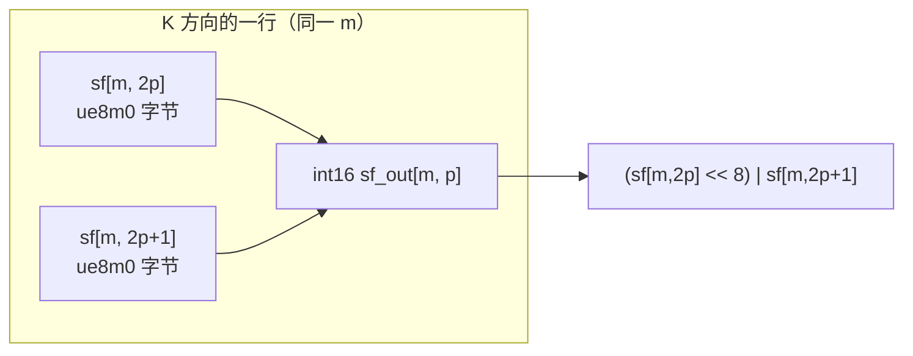

# 图 1：scaling factor 的 int16 打包与 MN-major 布局

**用途**：正文 §2.2。

**事实来源**（静态阅读）：

* `DeepGEMM-Ascend/README.md:48-50`（NOTE：每对 UE8M0 打包成 `int16`、MN-major）。
* `DeepGEMM-Ascend/csrc/apis/layout.hpp:19-36`（输出是 packed ue8m0x2、MN-major、
  形状 `[..., MN, ceil(K/32/2)]`）。
* `DeepGEMM-Ascend/csrc/jit_kernels/transform_sf.hpp:45-55`（物理形状
  `[..., K/64, MN]` 再转置）。
* `DeepGEMM-Ascend/deep_gemm/include/deep_gemm/transform_sf.hpp:251-280`
  （`shiftright 23` / `shiftright 15` / `or` 的合并）。

## 逻辑视图：沿 K 每两个 ue8m0 合成一个 int16



## 物理视图：MN 是连续维

```text
sf_out 的逻辑形状：   [MN, ceil(K / 64)]
sf_out 的物理内存：   p（第几个 K 对）为外层，m（MN）为内层

         m=0        m=1        m=2        ...   m=MN-1
p=0   ┌──────────┬──────────┬──────────┬─────┬──────────┐
      │ int16    │ int16    │ int16    │ ... │ int16    │  ← 连续
p=1   ├──────────┼──────────┼──────────┼─────┼──────────┤
      │ int16    │ int16    │ int16    │ ... │ int16    │
 ...  │   ...    │   ...    │   ...    │ ... │   ...    │
      └──────────┴──────────┴──────────┴─────┴──────────┘
         stride(-2) == 1  →  Major::MN
```

## 要点

* **打包率是 2**（NVIDIA SM100 是 4），所以 K 方向的 SF 元素数减半：
  `ceil(K/32)` → `ceil(K/64)`。
* **MN-major 是必须的**，因为 `T.copy` / `copy_gm_to_l1_mx` 的加载路径按这个方向
  设计（`deep_gemm/include/deep_gemm/ascend/copy.hpp:160-198`）。
* `gran_k` 只能是 32（`csrc/apis/layout.hpp:55`）；不满足时直接断言失败，
  不会静默走慢路径。
* fp32 输入时只有低 23 位为 0 的数值才被接受（`transform_sf.hpp:13-21`）。

