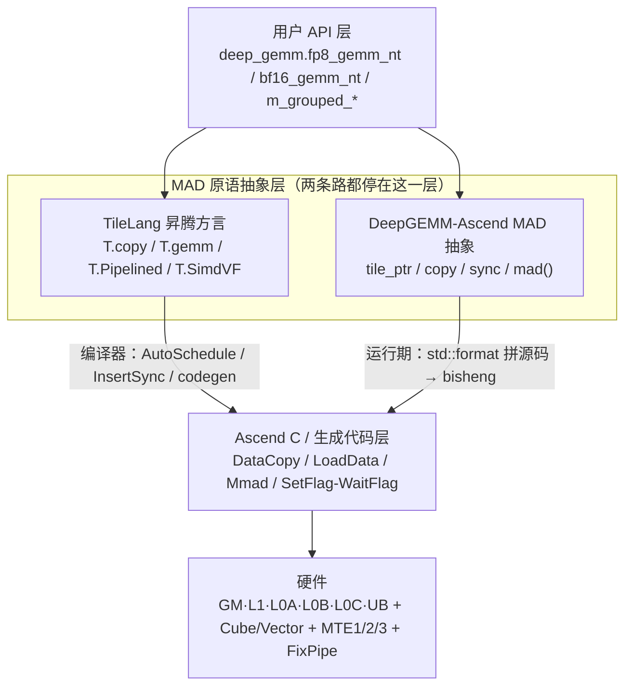

# 图 2：昇腾 GEMM 的四层抽象与两条实现路线

**用途**：正文 §2.4。

**事实来源**（静态阅读）：

* `DeepGEMM-Ascend/deep_gemm/include/deep_gemm/ascend.hpp:5-11`（三个头文件的分工注释）。
* `DeepGEMM-Ascend/deep_gemm/include/deep_gemm/ascend/copy.hpp:371-380`（`mad()` 出口）。
* `DeepGEMM-Ascend/csrc/jit_kernels/bf16_gemm.hpp:16-77`（字符串拼源码 → DeepJIT → launch）。
* 第 25 章 §2.5 / §4.1（TileLang 昇腾后端的四条路线与 pass 管线）。

**要点**

* 两条路线**共享最上面两层**：调用方接口相同，抽象意图相同（都写 tile 级数据流）。
* 分歧只在「怎么降到 Ascend C」：TileLang 交给编译期，DeepGEMM-Ascend 交给运行期
  的字符串实例化 + JIT 编译。
* 两者的产物在同一层（Ascend C），因此它们是**同一层上的两种工程选择**，
  不是上下层关系。

