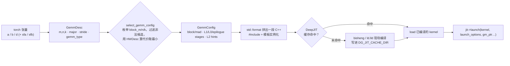

# 图 3：从一个 shape 到一次 launch

**用途**：正文 §4.1。

**事实来源**（静态阅读）：

* `DeepGEMM-Ascend/csrc/apis/gemm.hpp:60-182`、`csrc/jit_kernels/gemm_config.hpp:39-127`。
* `DeepGEMM-Ascend/csrc/jit_kernels/heuristics.hpp:575-719`。
* `DeepGEMM-Ascend/csrc/jit_kernels/bf16_gemm.hpp:16-77`。
* `DeepGEMM-Ascend/csrc/jit/jit.hpp:78-91`；`DeepJIT/README.md:9-16,34-52`。

**要点**

* `GemmConfig` 里的每个数字都会变成内核的**模板参数**，所以运行期没有分支。
* 缓存 key 覆盖源码、追踪到的 include、编译器版本与选项，改了头文件就会重新编译。
* `DG_PRINT_CONFIGS=1` 会在“每个 shape 第一次被编译”时打印一行选中的 config
  （`heuristics.hpp:714-718`），是读懂这个库最省事的入口。

