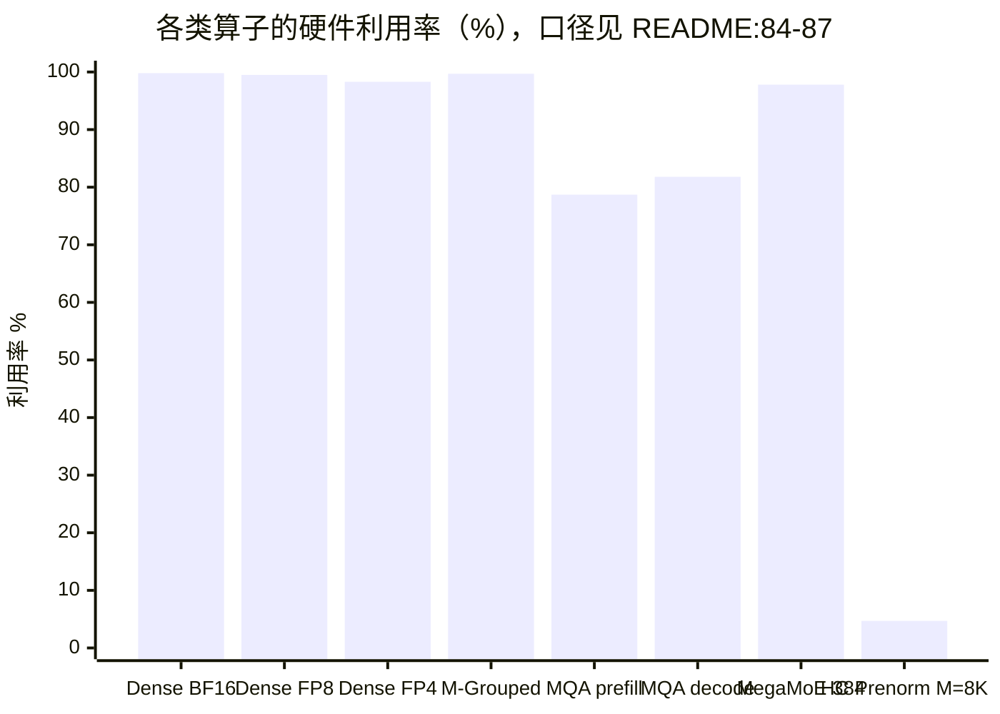

# 图 4：五张性能表的利用率对照

**用途**：正文 §5.2。

**事实来源**：`DeepGEMM-Ascend/README.md:90-170` 的六张表（口径：
Ascend 950DT / CANN 9.20 / `bench_msprof` / 冷 L2，见 `README.md:84-87`）。

**复算**：“Hardware limit”一列不是宣传口径，它可以由源码里的硬件模型复算出来
（`heuristics.hpp:46-48,52-71`）：

```text
峰值 = get_mad_flops_per_cycle(elem_bits) × 主频 × 核数
     = (8192 × 16 / elem_bits) × 1650 MHz × 32
bf16 → 432.5 TFLOPS        fp8 → 865.0 TFLOPS        fp4 → 1730.1 TFLOPS
```

（脚本：本章 `code/02-perf-ledger/`。）

## 利用率（Computation ÷ 该格式的硬件极限）



```text
利用率（本书复算，取自对应表格的 Computation / 硬件极限）

Dense BF16        431 / 432   = 99.8%
Dense FP8×FP8     861 / 865   = 99.5%
Dense FP4×FP4    1701 / 1730  = 98.3%
M-Grouped 最优    862 / 865   = 99.7%   （8 组 × 4096 那一行的最高值）
MQA prefill FP8   681 / 865   = 78.7%   ← FIX-pipe bound 的上界
MQA decode FP4    708 / 865   = 81.8%
MegaMoE 384/16384 846 / 865   = 97.8%
HC Prenorm M=8192  82 / 432   =  4.7%（it 不是算力问题，只有算力利用率才有意义）

对照：HC Prenorm M=8192 的带宽利用率 = 3463 / 3500 = 98.9%
```

**要点**

* **同一张表的“利用率”要看分母是哪条流水线**：dense / grouped / MegaMoE 用算力
  极限；MQA 的官方口径是 FIX pipe 99%；HC prenorm 应看带宽。
* 把 HC prenorm 的 4.7% 当成“很差”是典型的读错表。它是 memory-bound，
  带宽利用率才是它的成绩。

