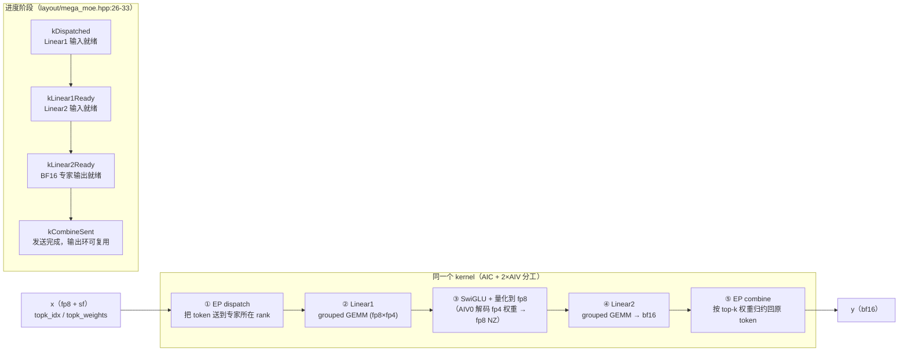

# 图 5：MegaMoE 的五段融合

**用途**：正文 §5.6。

**事实来源**（静态阅读）：

* `DeepGEMM-Ascend/README.md:146-158`（官方定义与性能表）。
* `DeepGEMM-Ascend/deep_gemm/include/deep_gemm/layout/mega_moe.hpp:26-33`（四个进度阶段）。
* `DeepGEMM-Ascend/deep_gemm/include/deep_gemm/mega_moe.hpp:20-107`
  （AIC/AIV0/AIV1 分工与 pipe event 分配）。
* `DeepGEMM-Ascend/csrc/apis/mega_moe.hpp:128-204`（缓冲区与约束）。

**要点**

* 五段被压进**一次 launch**：中间结果不再写回 HBM 再读出来，通信与计算重叠。
* 代价是约束变紧：多进程 + HCCL 对称缓冲区、形状必须提前注册、
  核数固定 32（`csrc/apis/mega_moe.hpp:159`）、每次 launch 要清 progress 区
  （`csrc/jit_kernels/mega_moe.hpp:43-46`）。
* 性能表里有**单独一列 Communication bandwidth**（33–135 GB/s），
  说明通信在这个融合 kernel 里是一等公民。

