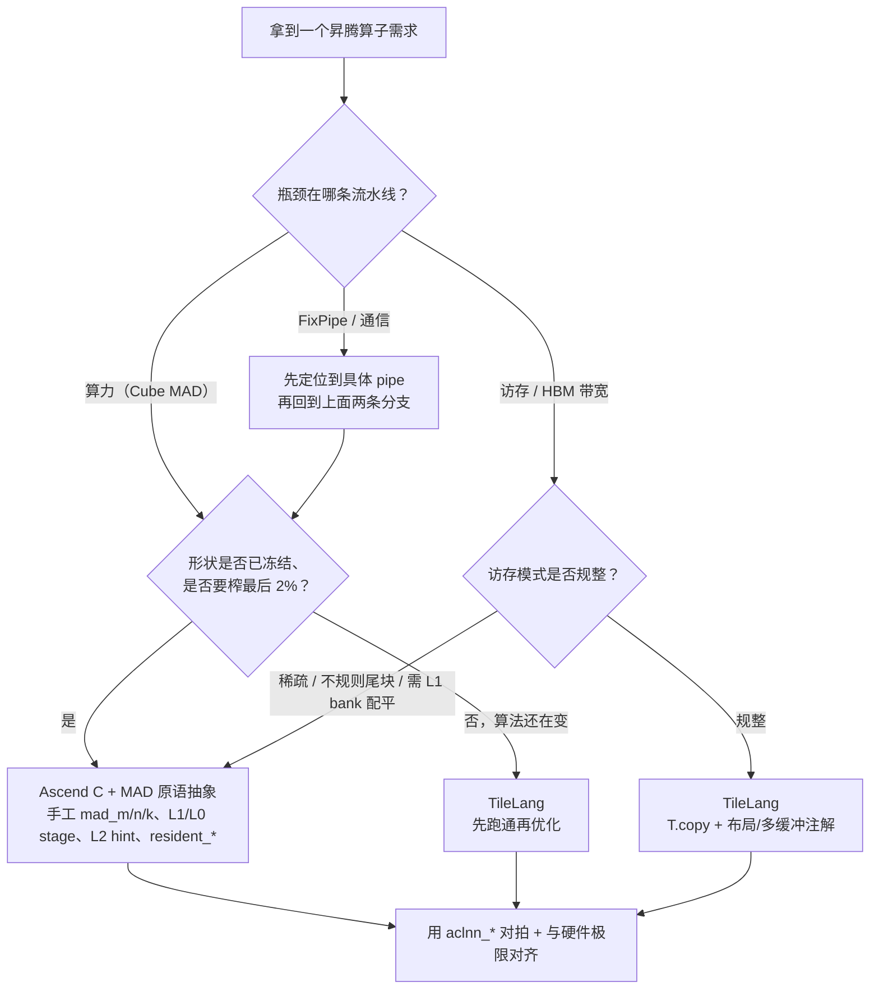

# 图 6：TileLang 与 Ascend C + MAD 的分工决策

**用途**：正文 §7.2。

**事实来源**：本章 §5.2–§5.7、§6.6 的分析，以及
`DeepGEMM-Ascend/README.md:3-11,190`；
`_vendor/tilelang-v0.1.15/tilelang/ascend/README.md:141-153`（第 19 章已核验）。

**要点**

* 主轴是**瓶颈类型**，不是「哪个更快」。
* 第二轴是「形状是否冻结」：DeepGEMM-Ascend 的配置几乎全是编译期常量，
  形状一动就要重编；TileLang 在算法迭代期的返工成本更低。
* 两条路都要做同一件事：**把结果和一份可信参考对齐**（对拍 or 手算极限）。
