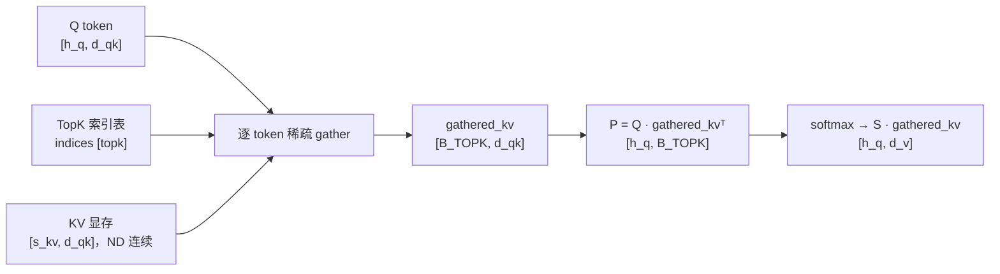

# 图 1：DSA 的稀疏访问与 TopK 索引

**用途**：正文 §2.1。

## 读图要点

1. **KV 是连续存储、访问是稀疏的**：`KV` 在显存里是 `[s_kv, 512]` 的连续矩阵
   （ND，stride `[d_qk, 1]`），但 `indices` 表把每个 q token 的读取位置打散。
2. **gather 的粒度是 token**：一次读一个 512 维 bf16 的行，即 1 KB；
   它不是一个矩阵乘，因此不能靠「整块搬运」来摊薄开销。
3. 这一条带来本章后面的三个后果：无法随路做 ND2NZ（§3.4）、MTE2 请求数爆炸
   （§3.3 bound ①）、每个 token 单独一次访存无法合并（§3.4）。

## 来源

* 报告 `:15-37`（数学建模：`gather → P → softmax → PV`）。
* `../tilelang-corpus/14-deepseek-ascend-stack/raw/FlashMLA/README.md:149-157`
  （`indices` 的形状与「非法位置填 -1」的约定）。
