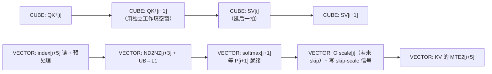

# 图 4：CUBE / VECTOR 双流水

**用途**：正文 §4.1–§4.2。时间从左到右。

## 读图要点

1. **CUBE 侧把两个 GEMM 交错排**：`QKᵀ[i+1]` 排在 `SV[i]` 之前，
   于是 `P[i]` 从「就绪」到「被用」之间有大约 1024 周期
   （报告 `:184`）给 FixPipe + softmax + S 回写。
2. **VECTOR 侧是一条深度 6 的流水**：源码里 `SYSTOLIC_ARR_DEPTH = 6`
   （`kernel_body.h:1273`），7 个动作按 `ACTIVATE` 偏移 5/3/1/5/0/1/5 排开
   （`kernel_body.h:1289-1322`）。
3. 偏移 5 出现了三次（index 读、index 预处理、KV 的 MTE2 拷贝）——
   它们是**同一个阶段里按顺序发起的三个动作**，因为 KV 拷贝要用预处理算出的地址。

## 来源

* 报告 `:166-200`（CUBE 侧 5 步与 VECTOR 侧 7 步、延后一拍的理由）。
* `kernel_body.h:1273`（`SYSTOLIC_ARR_DEPTH = 6`）、`:1289-1322`（`ACTIVATE` 排布）。
