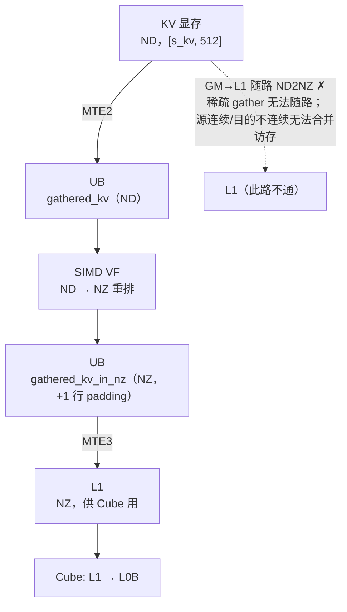

# 图 5：KV 的 ND → UB → NZ → L1 路径

**用途**：正文 §3.4。

## 读图要点

1. 虚线那条是报告试过并否掉的方案（`:152`）：AI Core 内部的 BIU
   **只在源和目标都连续时才触发访存合并**，而「源连续、目的 strided」不行，
   于是 L2 带宽利用率很低，瓶颈落回 L2。
2. 实线那条是最终方案（`:154`）：先 MTE2 到 UB，用 SIMD VF 在片上把 ND 转 NZ，
   再 MTE3 推到 L1。
3. NZ buffer 故意多 pad 一行（`(B_TOPK_PER_V+1)*D_VO`，`config.h:81`），
   避免写回时的 UB bank conflict。

## 来源

* 报告 `:146-154`（ND2NZ 时机的完整讨论）。
* `kernel_body.h:1018-1112`（`run_issue_kv_gather` → ND2NZ VF → `asc_copy_ub2l1`）；
  `config.h:81`（+1 行 padding）。
