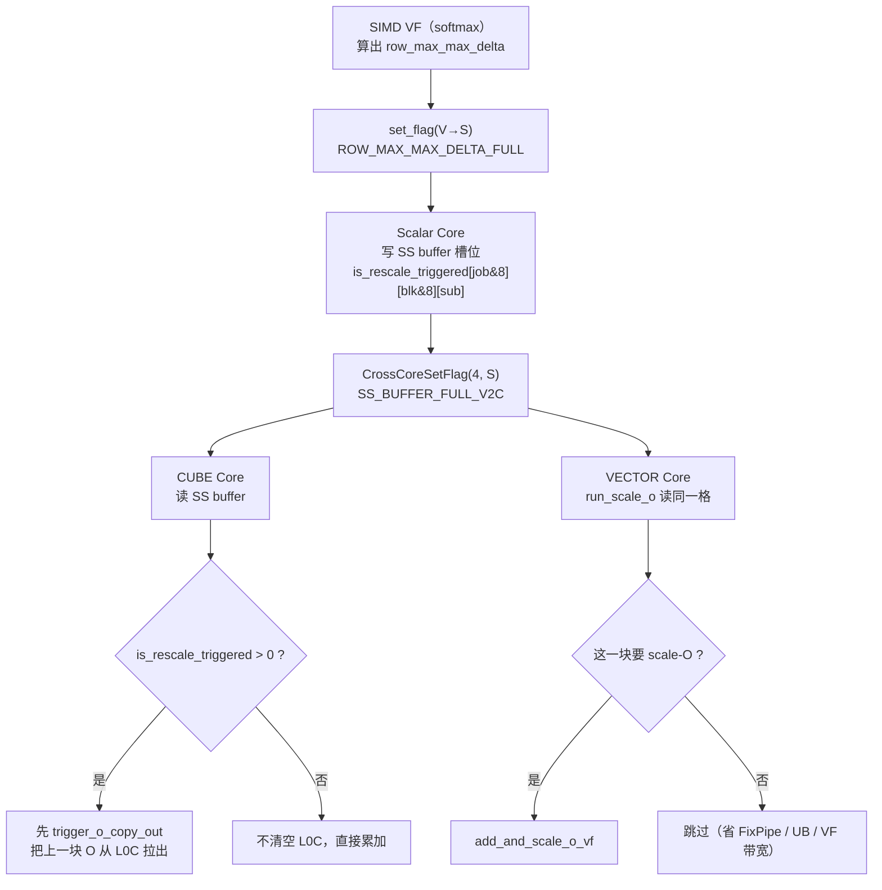

# 图 7：skip-scale 的信号传递

**用途**：正文 §4.3–§4.4。

## 读图要点

1. 生产者是 **SIMD VF**，消费者是 **CUBE 与 VECTOR 两者**（报告 `:162`）：
   Cube 要决定是否清空 L0C，Vector 要决定是否做 `add_and_scale_o_vf`。
2. 中间必须经过 **Scalar Core**：只有它能读写 SS buffer
   （`__ssbuf__`，`config.h:110-112`），所以
   `SIMD VF → Scalar Core` 是**阻塞式**同步（报告 `:204`）。
3. `CrossCoreSetFlag<4, PIPE>(id)` 里的 `4` 是「同时发给两个 AIV」的模式，
   helper 会发 `id` 与 `id+16` 两份（`kernel_body.h:69-81`）——
   这正是 1C2V 带来的协议。
4. 加上「各条 PIPE 顺序发射、顺序执行」（报告 `:206`），
   一次没排好的等待就会卡住整条 `PIPE_V`；所以 `systolic_arr_activate`
   会按情况把 `set_is_rescale_triggered_flag` 提前
   （`kernel_body.h:1306-1319`）。

## 来源

* 报告 `:156-162`（skip-scale 的同步方案）、`:202-206`（为什么流水复杂）。
* `kernel_body.h:69-81`（2aiv flag）、`:1186-1193`（写 SS buffer）、
  `:1585-1590`（CUBE 读）、`:1205-1207`（VECTOR 读）、`:1306-1319`（发起顺序）。
