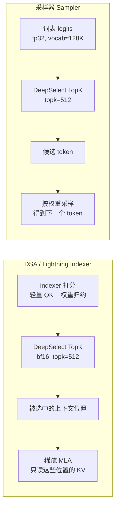

# 图 1：TopK 在 DeepSeek 推理里的两个位置

**用途**：正文 §1.1、§1.2。

来源：`../../tilelang-corpus/14-deepseek-ascend-stack/raw/DeepSelect/README.md:3-37`
（两个使用场景）、`.../DeepSelect/docs/DeepSelect-deep-dive.zh.md:3`
（“DSA 从大量 context token 中选最相关的位置；采样阶段从较大的词表里选候选 token”）。

## 读图提示

* 两处 TopK 的**形状很不一样**：DSA 侧是 bf16、行长可以到百万（context 越长越好）；
  采样侧是 fp32、行长固定在词表大小（≈128K）。
* 两处 TopK 的**共同点**才是本章的主题：`k` 都很小（≤ 4096，主要是 512），而
  `N` 都很大，所以“怎么少读、怎么不排序”决定了端到端性能。
* 图里的 `topk=512` 取自仓库自述“mainly optimized for `topk=512`（即 DeepSeek V4
  的 topk）”（`README.md:23`）。
