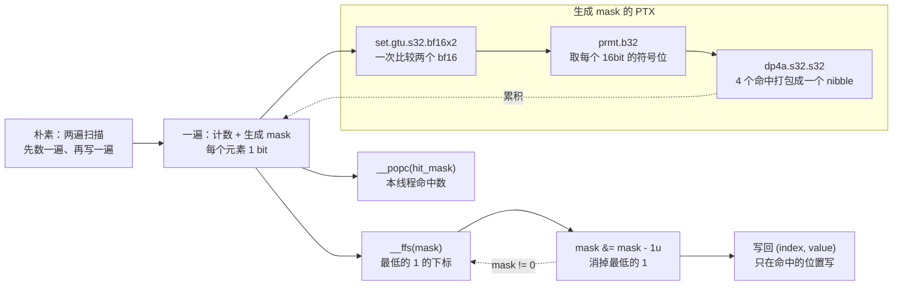

# 图 4：CUDA 侧一遍扫描的 mask 流程

**用途**：正文 §4.2、§4.3。

来源：`.../DeepSelect/docs/DeepSelect-deep-dive.zh.md:107-111`（两遍 → 一遍、`__ffs`、
`mask &= mask - 1u`、`set.s32.bf16x2` / `prmt.b32` / `dp4a.s32.s32`、warp 前缀和、
字节提取、直方图构建）。指令出现在
`.../DeepSelect/csrc/cuda_kernels/common_parts.cuh:1413-1425`（mask 生成）、
`:1449-1484`（按 mask 写回）。

## 读图提示

* 朴素的“两遍”写法里，第一遍数命中个数只是为了**知道往哪写**；mask 把这遍
  “数”与“生成可枚举位图”合二为一，第二遍就不用再扫过没命中的元素。
* 命中越稀疏（`T` 升上去以后），`__ffs` 循环体执行的次数越少。这是“筛选”的好处
  在实现层的体现。
* `dp4a` 那一行把 **4 个比较结果压进 `hit_mask` 的一个 nibble**，一次处理 4 个元素
  （`common_parts.cuh:1413-1425`）。
* `__popc` / `__ballot_sync` / warp 前缀和负责**给每个线程算写回偏移**，与 mask 的
  枚举是同一遍里的两件事。
