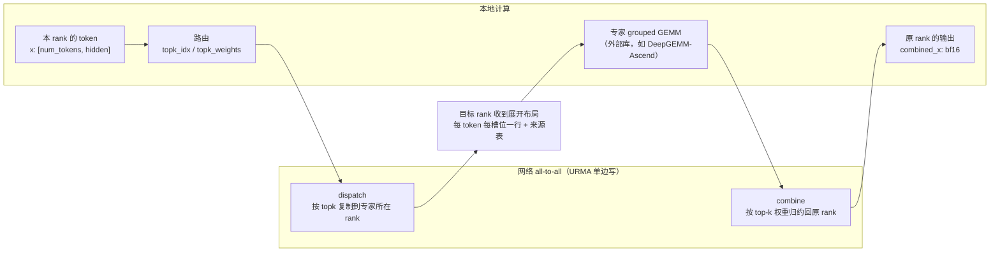

# 图 1：一个 token 的 dispatch / combine 数据流

**用途**：正文 §2.1。

**事实来源**（静态阅读）：

* `DeepEP-Ascend/README.md:3`（EP all-to-all 的定位）、`:120-172`（dispatch/combine 的用法）。
* `DeepEP-Ascend/deep_ep/include/deep_ep/impls/ep/dispatch.hpp:171-294`（路由、去重、槽位分配）。
* `DeepEP-Ascend/deep_ep/include/deep_ep/impls/ep/combine.hpp:59-151`（按来源表回送）、`combine_utils.hpp:14-90`（FP32 归约）。
* `DeepEP-Ascend/deep_ep/include/deep_ep/layout/ep/token.hpp:9-83`（每 token 的字节布局）。

**要点**

* dispatch 走的是“**复制**”：一个 token 的 k 个专家分布在几个 rank，
  它就被复制几份（同一 rank 内去重，只传一次）。
* 每份 payload 除了 hidden，还带 `topk_idx`、`topk_weights` 与源 token 全局下标
  （来源表），combine 靠它找回原位置。
* combine 是“**归约**”：k 份专家输出按路由权重加权求和，累加在 FP32 里做。
* 反向传播时两者互换：dispatch 的反向是 combine，combine 的反向是 dispatch。
