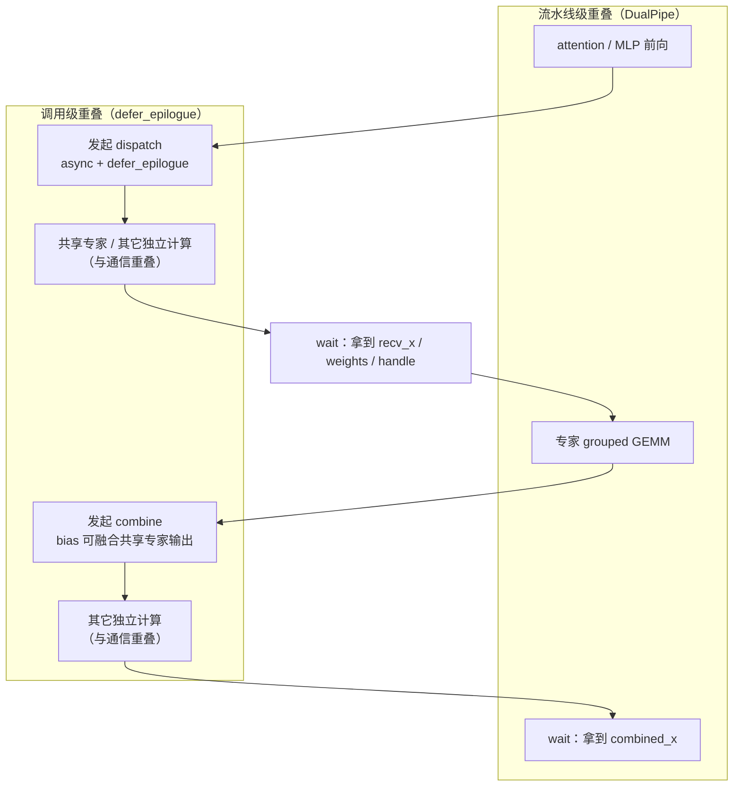

# 图 2：训练一步里通信的位置

**用途**：正文 §2.5、§3.4、§9.3。

**事实来源**（静态阅读）：

* `DeepEP-Ascend/README.md:175-196`（「先发起、后等待」的骨架）。
* `DeepEP-Ascend/deep_ep/buffers/ep.py:500-504`（epilogue 的 hook 时机）。
* `DeepEP-Ascend/csrc/buffers/ep.hpp:396-402`（defer epilogue 的 C++ 分支）。
* `DualPipe/README.md:3`（训练侧 full overlap 的定位）。

**要点**

* 不重叠时，`dispatch → GEMM → combine` 之间是串行等待，等待时间由**最慢的 rank** 决定。
* `async_with_compute_stream` + `defer_epilogue` 把「发起」和「收尾」拆开，
  中间那段空白可以放共享专家或其它独立计算。
* 更外层的重叠交给 DualPipe：前后向 chunk 的计算-通信整体错开。
* 三层重叠可以叠加，互相不冲突。
