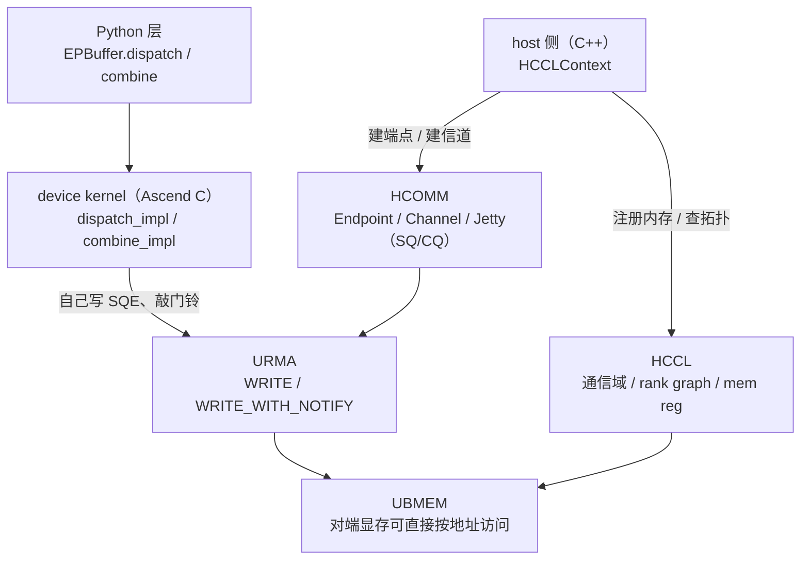

# 图 4：DeepEP-Ascend 的通信栈分层

**用途**：正文 §5。

**事实来源**（静态阅读）：

* `DeepEP-Ascend/README.md:3`、`:28`（HCCL/HCOMM、UBMEM、URMA 与硬件要求）。
* `DeepEP-Ascend/csrc/kernels/comm/hccl.hpp:76-97`（内存注册、netlayer 1、UBMEM 信道、Jetty）。
* `DeepEP-Ascend/csrc/kernels/comm/symmetric.hpp:11-25`（`aclrtMalloc` 出的对称内存）。
* `DeepEP-Ascend/deep_ep/include/deep_ep/comm/handle.hpp:22-32,167-213,235-302`
  （SQE 模板、Jetty 资源、WRITE / WRITE_WITH_NOTIFY）。
* `DeepEP-Ascend/csrc/kernels/comm/api.hpp:82-89`（物理/逻辑域 = `{1, num_ranks}`）。

**要点**

* **HCCL**：通信域句柄、拓扑（固定用 netlayer 1，即超节点 external Clos 网络）、
  注册对称内存、拿对端地址。
* **HCOMM**：建端点与信道、拿 Jetty；设备侧从 Jetty 里读出 SQ/CQ 的地址与深度。
* **UBMEM**：统一总线内存，对端显存可按地址访问；要求每对 peer 直连。
* **URMA**：单边内存访问；数据路径上只有 WRITE 与 WRITE_WITH_NOTIFY，没有 READ、没有双边握手。
* 两个「域」都是 `{1, num_ranks}`：整个 EP group 被当成单个 UB 域（对应 NVIDIA 侧的「无 RDMA 域」）。

**边界**：图中 HCCL / HCOMM 的头文件由 CANN 提供，不在 corpus 快照里；
本图只根据 README 措辞与源码里的调用点描述分工，不代表 CANN 内部实现。
