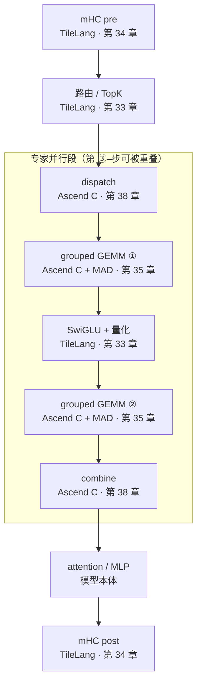

# 图 1：训练一步的全栈流水

**用途**：正文 §2.1、§2.2、§2.7。

**事实来源**（都是前面章节已经引用过的一手材料）：

* 第 32 章 §5.4 的训练 step 调用骨架（路由 → dispatch → grouped GEMM → SwiGLU →
  grouped GEMM → combine → mHC）。
* `../tilelang-corpus/14-deepseek-ascend-stack/raw/DeepEP-Ascend/README.md:175-196`
  （「先发起、后等待」的 dispatch / combine 骨架）。
* `../tilelang-corpus/14-deepseek-ascend-stack/raw/TileKernels/tile_kernels/mhc/__init__.py`
  与 `../tilelang-corpus/14-deepseek-ascend-stack/raw/TileKernels/tile_kernels/moe/topk_gate_kernel.py:7-43`（TileLang 覆盖的算子）。
* `../tilelang-corpus/14-deepseek-ascend-stack/raw/DeepGEMM-Ascend/README.md:190`
  与 `deep_gemm/tilelang_ops/hc_prenorm.py`（GEMM 侧的分工）。

**要点**

* **TileLang 覆盖两端与中间一小段**（mHC、路由、SwiGLU+量化），最贵的两段 GEMM
  与两段通信都在 Ascend C 里——第 35、38 章各给了理由。
* **dispatch / combine 是零 FLOP 的搬运**，字节量却与这一层 GEMM 的访存同量级
  （第 38 章 §1.2）。
* 反向不在这张图里：`combine 的反向 = dispatch`、`dispatch 的反向 = combine`
  （第 38 章 §2.3），另外还有 mHC 的梯度归约与多层重算（第 34 章 §4.3、§6.5）。
