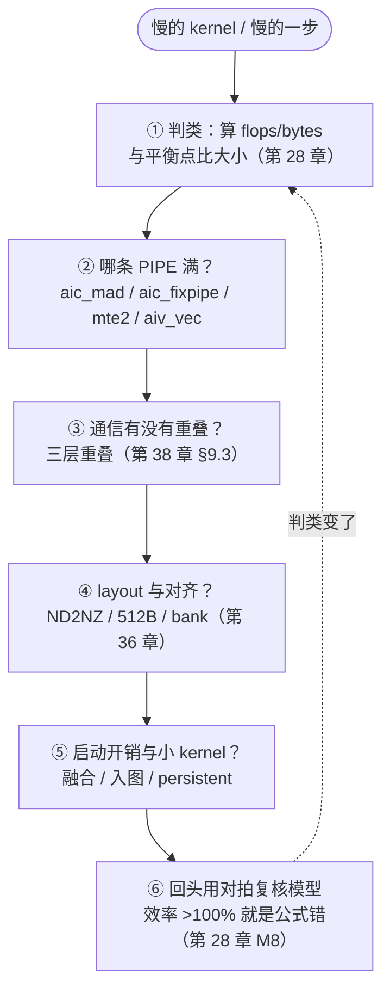

# 图 4：瓶颈定位的检查顺序

**用途**：正文 §5.1、§5.2。

**事实来源**：每一步的判据都取自前面章节，逐条标注在正文 §5.2 的表里。

**要点**

* 这是**检查顺序**，不是「六件事都要做一遍」。多数情况下前两步就能定位。
* ②/③ 的先后取决于 ① 的判类结果：compute-bound 先看 ②，
  通信占比高的先看 ③（正文 §5.4 的走查演示了这条）。
* 走不到 ② 而直接进 ⑤，通常意味着这个算子已经接近它的形状能给的极限。
